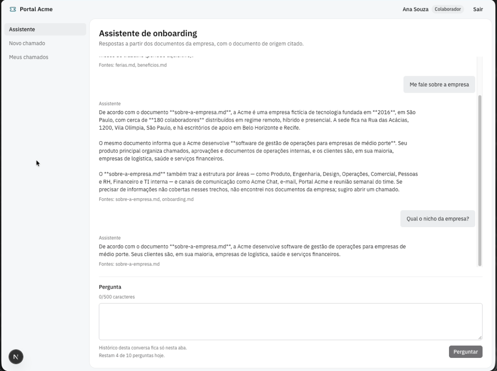

# Portal Acme



Portal interno de uma empresa fictícia: um assistente de onboarding **com RAG**
(Retrieval-Augmented Generation) responde dúvidas a partir dos documentos da empresa e,
quando não encontra a resposta, o colaborador abre um chamado para o time de TI ou de RH.

**Demo online:** [projeto-acme-rag.vercel.app](https://projeto-acme-rag.vercel.app/login) —
as contas de demonstração aparecem na tela de login e estão listadas no fim deste README.

## O problema

Colaboradores novos fazem as mesmas perguntas (acessos, benefícios, férias) e dependem de
outras pessoas para respondê-las. Quando a dúvida não está documentada, falta um canal
registrado para resolvê-la.

O portal cobre os dois lados: o assistente responde com base nos documentos oficiais e
cita a fonte; o que não for resolvido vira um chamado com fila, atendente e resposta.

## O que dá para fazer

- **Colaboradora**: conversa com o assistente, vê a resposta com o documento de origem e
  abre um chamado com a pergunta já preenchida quando não há resposta na base.
- **Atendente de TI / RH**: vê a fila da sua categoria, assume o chamado, responde e
  acompanha o status.
- **Atendente de TI**: gerencia a base de conhecimento em `/documentos`, com a lista dos
  documentos, o envio de um ou mais arquivos `.md` (nome existente substitui a versão
  anterior) e a remoção de um documento.
- **Colaboradora (fechamento)**: lê a resposta e fecha o chamado quando estiver
  resolvido.

## Assistente com RAG

As respostas não vêm da memória do modelo: cada uma sai de trechos recuperados dos
documentos oficiais da Acme.

- **Ingestão**: o atendente de TI envia um `.md` pelo portal e o n8n divide o texto em
  trechos (1000 caracteres, com 150 de sobreposição), gera os embeddings com
  `openai/text-embedding-3-small` e grava na tabela vetorial do Supabase (pgvector). Um
  arquivo com nome existente substitui apenas aquele documento.
- **Recuperação**: a pergunta vira embedding e a busca vetorial (`acme_match_documents`,
  `topK` 4) traz os trechos mais próximos.
- **Gate de relevância**: trecho com score abaixo de 0,4 é descartado. Se nenhum passa, o
  modelo nem é chamado e a resposta volta como `grounded: false`, com a oferta de abrir
  chamado — o assistente prefere dizer que não encontrou a inventar uma resposta.
- **Resposta**: o modelo recebe apenas os trechos recuperados e responde citando o
  documento; as fontes exibidas abaixo de cada resposta vêm do workflow, não do texto
  livre do modelo.

## Stack

- Next.js 16 (App Router) e React 19, TypeScript estrito
- Tailwind CSS 4
- Supabase: Auth, Postgres com RLS e pgvector
- n8n para a ingestão e a consulta RAG; OpenRouter para embeddings e modelo de chat
- Vitest e React Testing Library

## Arquitetura

```
Navegador
   │ cookies HttpOnly
   ▼
Next.js (Server Components, Server Actions, src/proxy.ts)
   ├── Supabase Auth + Postgres (RLS, pgvector)
   └── n8n ── OpenRouter (embeddings e deepseek)
```

- O segredo do webhook do n8n e a chave `service_role` existem só no servidor.
- A pergunta sai do Next por uma Server Action e chega ao n8n com um header secreto.
- A resposta segue um contrato fixo: texto, lista de fontes e um indicador de que houve
  base documental.
- A base de conhecimento é atualizada pelo portal, por um webhook autenticado, ou pelo
  formulário do n8n; cada envio substitui apenas as fontes enviadas.

## Como rodar

```bash
pnpm install
cp .env.example .env.local   # preencha as variáveis
pnpm dev                     # http://localhost:3000
```

Para funcionar, o ambiente precisa de:

- um projeto Supabase com as tabelas e funções `acme_*` criadas a partir de
  `docs/sql/001_schema.sql` (inclui as políticas de RLS);
- os três usuários de demonstração criados no Supabase Auth e os perfis
  correspondentes em `acme_profiles`;
- os workflows do n8n (exportados em `n8n/`, sem credenciais — selecione as do Supabase e
  do OpenRouter na importação).

A senha de `/documentos` é o valor de `DOCS_ADMIN_PASSWORD` definido no `.env.local`.

## Contas de demonstração

Usuários fictícios, com senhas públicas de propósito: são contas de portfólio, sem dado
real.

| Perfil | E-mail | Senha | Tela inicial |
|---|---|---|---|
| Colaboradora | `ana@acme.demo` | `acme@123` | `/chat` |
| Atendente de TI | `ti@acme.demo` | `acme@456` | `/fila` |
| Atendente de RH | `rh@acme.demo` | `acme@789` | `/fila` |

Projeto de portfólio, com dados fictícios.
